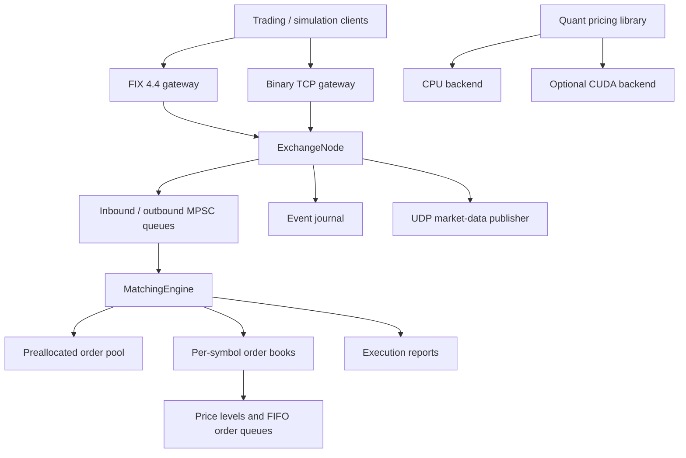

<div align="center">

# UltraLOB Engine

### Low-latency market infrastructure in modern C++

[](https://en.cppreference.com/w/cpp/20)
[](https://cmake.org/)
[](LICENSE)
[](https://github.com/ram-mittal/ULTRALOB-engine-/actions/workflows/cpp-engine.yml)
[](https://github.com/ram-mittal/ULTRALOB-engine-/stargazers)

**A C++20 limit order book and matching-engine codebase with FIX 4.4 connectivity, asynchronous sequencing, event journaling, market-data publishing, and quantitative Monte Carlo pricing.**

[Explore the code](https://github.com/ram-mittal/ULTRALOB-engine-)
· [Report an issue](https://github.com/ram-mittal/ULTRALOB-engine-/issues)
· [Contribute](#contributing)

</div>

---

## What is UltraLOB?

**UltraLOB Engine is the C++ market-infrastructure layer of my broader UltraLOB software project.** It is designed to provide the order-management, matching, messaging, journaling, and quantitative-computing foundation beneath higher-level UltraLOB services.

The broader UltraLOB project explores strategy distribution and copy-trading workflows alongside trading infrastructure. This repository focuses on the standalone systems-engineering component: the C++ engine and its benchmarks. The web application, broker-account workflows, MT5 integration, private strategy catalogue, and product backend are maintained separately and are intentionally not included here.

The goal is to make the core engine inspectable and useful to developers interested in exchange-style matching systems, performance engineering, market connectivity, and quantitative infrastructure.

## At a glance

| Area | Included in this repository |
|---|---|
| Language and standard | C++20 |
| Core | Limit order book and matching engine |
| Order handling | Limit, market, IOC, FOK, stop, and stop-limit paths |
| Book organisation | Per-symbol books, price levels, FIFO queues |
| Allocation | Preallocated order pool and atomic free-list operations |
| Connectivity | FIX 4.4 components and binary TCP gateway |
| Runtime | Dedicated exchange node with inbound/outbound queues |
| Persistence | Memory-mapped event journal and replay |
| Market data | UDP multicast publisher |
| Quant | CPU Monte Carlo pricing and optional CUDA backend |
| Validation | Unit/integration tests and Google Benchmark suites |
| Build | CMake 3.28+ |

## Architecture

The repository separates the matching core from the runtime adapters and quantitative-pricing library.



### Core design

- **Order book and matching:** price-level organisation with FIFO order queues, order insertion/removal, matching, cancellation, modification, and stop-order activation paths.
- **Order allocation:** a preallocated order slab with atomic free-list operations to recycle order objects.
- **Exchange runtime:** an `ExchangeNode` wraps the matching engine with inbound and outbound queues and a dedicated processing thread. Optional CPU-core affinity is exposed by the runtime.
- **Protocol adapters:** FIX components cover message framing, message construction, session/store functionality, initiator, and gateway code. A separate binary TCP gateway is also included.
- **Event journal:** a memory-mapped journal supports appending client requests and replaying recorded requests during recovery. Explicit flush operations are available.
- **Market data:** a UDP multicast publisher emits engine market-data updates using the protocol defined in this project.
- **Quantitative computing:** Monte Carlo pricing is kept in a separate library, with a CPU implementation and an optional CUDA implementation.

## Performance engineering and benchmarks

Performance should be measured against a defined workload and machine—not inferred from source code or a benchmark's configured iteration count. The repository includes dedicated benchmark executables so results can be reproduced and compared.

| Benchmark | What it exercises |
|---|---|
| `bench_latency` | Limit add, add/cancel, immediate cross/fill, and market-order paths; collects cycle-sample percentiles |
| `bench_throughput` | Limit-order posting, aggressive crossing, add/cancel, market-order flood, and mixed workloads |
| `bench_sequencer` | Asynchronous request/report round-trip and pipelined queue throughput |
| `bench_scaling` | Thread-count and active-symbol-count benchmark scenarios |
| `bench_journal` | Memory-mapped journal append workload |
| `bench_memory` | Order/price-level sizes, estimated pool footprint, and process memory where supported |
| `bench_monte_carlo` | CPU pricing across path counts, plus CUDA cases when CUDA is enabled |
| `bench_profiler` | Profiling instrumentation workload |

### Run the benchmark suite

Build in Release mode first, then run an individual benchmark executable:

```bash
./build/bench_latency
./build/bench_throughput
./build/bench_sequencer
./build/bench_scaling
./build/bench_journal
./build/bench_memory
./build/bench_monte_carlo
```

For a longer Google Benchmark run, pass a minimum measurement time, for example:

```bash
./build/bench_throughput --benchmark_min_time=1s
```

On multi-configuration Windows generators, executables are commonly under `build/Release/`.

### Benchmark reporting standard

No headline throughput or latency number is claimed in this README. The source contains benchmark workloads and iteration settings, but those settings are not measured results. Publish results only after running the benchmark and recording:

- CPU model, core count, memory, and operating system/kernel
- Compiler version, CMake version, build type, and relevant compiler flags
- CPU governor/power mode, affinity settings, and whether the machine was otherwise idle
- Number of repetitions and warm-up policy
- Throughput in operations/second and latency percentiles (at minimum p50, p99, and p99.9)
- Whether reported latency is wall-clock time, nanoseconds, or raw timestamp-counter cycles

The latency harness collects timestamp-counter cycle samples on x86 and reports cycle counters; do not label those counters as nanoseconds without a documented, appropriate conversion. Results will vary with hardware, compiler, operating system, workload, and configuration.

> **Performance note:** the presence of AVX2/FMA compiler flags and benchmark targets describes the build and test configuration; it does not establish a particular latency, throughput, or production-performance guarantee.

## Build from source

### Requirements

- CMake **3.28 or newer**
- A C++20-capable compiler (for example, a recent GCC, Clang, or MSVC toolchain)
- x86-64 processor with AVX2/FMA support for the current optimized GCC/Clang configuration
- Network access during the first CMake configure, because dependencies are fetched with CMake FetchContent
- Optional: NVIDIA CUDA Toolkit for the CUDA Monte Carlo backend

The build fetches these external dependencies during configuration:

- Google Test 1.15.2
- Google Benchmark 1.9.1
- Standalone Asio 1.30.2

### Linux / macOS / GCC / Clang

```bash
git clone https://github.com/ram-mittal/ULTRALOB-engine-.git
cd ULTRALOB-engine-

cmake -S . -B build -DCMAKE_BUILD_TYPE=Release
cmake --build build --parallel 2
ctest --test-dir build --output-on-failure
```

### Windows / Visual Studio

From a Developer PowerShell with CMake and Visual Studio C++ build tools installed:

```powershell
git clone https://github.com/ram-mittal/ULTRALOB-engine-.git
cd ULTRALOB-engine-

cmake -S . -B build -A x64
cmake --build build --config Release --parallel 2
ctest --test-dir build -C Release --output-on-failure
```

### Optional CUDA pricing backend

CUDA is disabled by default. To enable it, configure with the CUDA option and a compatible NVIDIA toolkit/compiler:

```bash
cmake -S . -B build-cuda \
  -DCMAKE_BUILD_TYPE=Release \
  -DULTRALOB_ENABLE_CUDA=ON

cmake --build build-cuda --parallel 2
```

## Run the server

After building, display the available server options:

```bash
./build/ultralob_server --help
```

The server exposes configurable binary TCP and FIX ports, a UDP multicast group/port, a journal path, a FIX store directory, and an optional CPU-core affinity setting. Run it in a controlled local or test environment and review the network/security configuration before exposing any listener beyond localhost or a trusted network.

## Repository layout

```text
.
├── include/ultralob/       Public engine, FIX, network, quant, and utility headers
├── src/                    Matching, order-book, runtime, FIX, journal, and quant sources
├── server/                 Server and protocol/pricing demos
├── tests/                  Unit and integration tests
├── bench/                  Latency, throughput, scaling, memory, journal, and quant benchmarks
├── .github/workflows/      Build-and-test CI workflow
├── CMakeLists.txt
├── LICENSE
└── README.md
```

## Engineering scope and limitations

This is an actively developed engineering codebase—not a certified exchange, broker, trading venue, or investment service. It should not be assumed production-ready solely because it builds or passes tests.

In particular:

- FIX components are project implementations; conformance against a counterparty's FIX certification suite has not been asserted here.
- The journal provides append, explicit flush, and replay functionality; production crash-consistency, corruption handling, and recovery guarantees require further fault-injection and durability testing.
- The risk-engine code is a component, not a substitute for independent validation of account, order, fill, cancellation, and exposure controls in a complete deployment.
- Benchmark scenarios are microbenchmarks. They do not by themselves establish end-to-end broker, network, exchange, or live-trading performance.
- The optional CUDA path requires a compatible toolkit and device; CPU builds do not require CUDA.

## Roadmap

Areas for continued engineering and community review:

- Publish reproducible benchmark reports across CPU/compiler configurations
- Expand deterministic replay, crash-recovery, and fault-injection testing
- Strengthen protocol conformance and gateway integration tests
- Extend performance analysis for contention, queue behaviour, and tail latency
- Improve deployment hardening, observability, and operational diagnostics

## Contributing

Issues, bug reports, benchmark comparisons, code reviews, and pull requests are welcome. For performance reports, include the exact command, commit, compiler/build configuration, machine specification, and raw output so others can reproduce the result.

If the project is useful to you, consider giving it a **star**. It helps other systems, quant, and market-infrastructure developers discover the work.

## License

Released under the [MIT License](LICENSE).

---

<div align="center">

**UltraLOB Engine** · A core systems project within the broader UltraLOB ecosystem.

Built by [Ram Mittal](https://github.com/ram-mittal).

</div>
